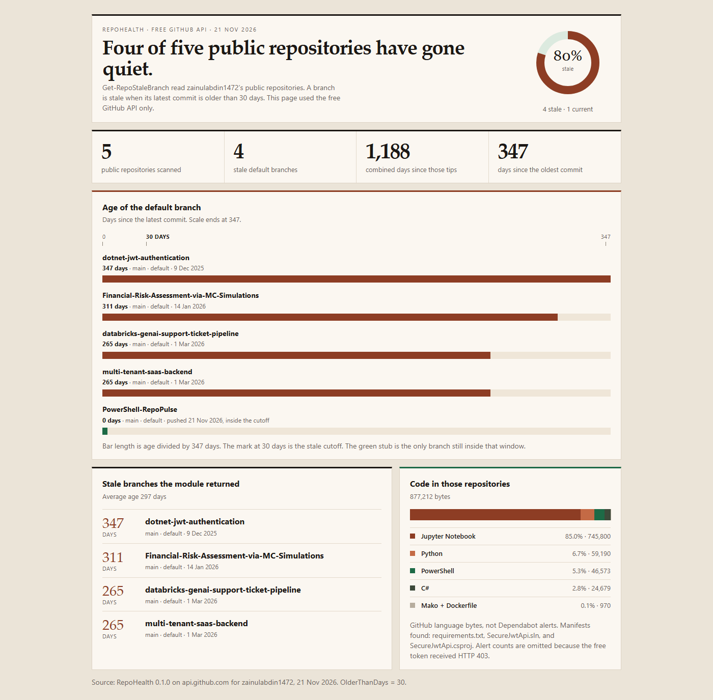

# RepoHealth

PowerShell 7 module that finds stale GitHub branches and Dependabot alerts, then writes a Markdown health report.

A branch is stale when its latest commit is older than a chosen number of days. The default is 30. Dependency status comes from the GitHub Dependabot alerts API, with an optional minimum severity. `New-RepoHealthReport` turns both results into Markdown and can write that file.

## What a real scan showed

On 21 Nov 2026 the module read the five public repositories on `zainulabdin1472` through the free GitHub API. Four of the five default branches were older than 30 days. Those four tips were 1,188 days old combined. The oldest, `dotnet-jwt-authentication`, was last committed on 9 Dec 2025, which was 347 days. The average age of the stale branches was 297 days. `PowerShell-RepoPulse` was the only current repository.



The board also shows GitHub’s language totals for those repositories: 877,212 bytes, of which Jupyter Notebook is 85.0 percent. Dependabot alert counts are not drawn. The token used for that scan was refused with HTTP 403 on every alerts request, so a zero would have been a guess.

## Commands

```powershell
Import-Module .\src\RepoHealth\RepoHealth.psd1

Get-RepoStaleBranch -Owner 'octocat' -Repository 'hello-world' -OlderThanDays 60

Get-RepoDependencyStatus -Owner 'octocat' -Repository 'hello-world' -MinimumSeverity 'high'

New-RepoHealthReport -Owner 'octocat' -Repository 'hello-world' -OutputPath .\health.md
```

Set `GH_TOKEN` or `GITHUB_TOKEN`, or sign in with GitHub CLI. The module reads `GH_TOKEN` first, then `GITHUB_TOKEN`, then `gh auth token`.

## Layout

`src/RepoHealth` is the module. `Public` holds the three exported commands. `Private` holds the GitHub request, token lookup, and Markdown cell formatting. `tests` contains the Pester 5 suite, and every GitHub call in those tests is mocked. `docs/impact.html` is the static board for the 21 Nov 2026 scan.
